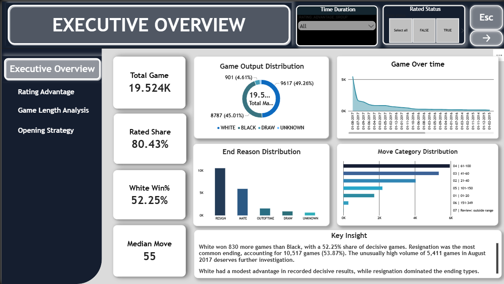

 # Chess Game Data Analytics Case Study


## Project Overview

This project presents an end-to-end analysis of a chess-game dataset containing 19,524 game records. It brings together data cleaning, exploratory data analysis (EDA), data visualization, and dashboard reporting to identify patterns in game outcomes, player ratings, recorded game length, opening choices, and game records over time.

The aim is to transform raw data into meaningful findings while documenting data-quality issues and interpreting results responsibly.

## Problem Statement

Chess-game datasets contain information about game results, player ratings, openings, move counts, and timestamps. However, inconsistencies, missing values, and unusual records can affect the reliability of analysis. This project addresses the need to prepare the data, investigate patterns in the available records, and communicate the findings through clear visualizations and a dashboard.

## Project Objectives

- Inspect and improve the quality of the dataset before analysis.
- Examine game outcomes and compare recorded wins by White and Black.
- Explore the relationship between player-rating differences and game outcomes.
- Investigate recorded game length, opening frequency, and monthly record volume.
- Present key findings through visualizations and a dashboard.
- Document analytical limitations and provide evidence-based conclusions.


## Dataset Information

- **Dataset:** Chess game records
- **Records analyzed:** 19,524
- **Data format:** CSV / Excel workbook
- **Domain:** Chess game outcomes and player statistics
- **Source:** Add the original dataset source or download link before publishing.

The dataset contains information about game outcomes, player ratings, recorded moves, chess openings, rated status, timestamps, and game termination reasons. The analysis uses these fields to investigate patterns while accounting for data-quality limitations.

## Tools and Technologies

- **Microsoft Excel:** Data cleaning, validation, exploratory data analysis, calculations, and summary tables.
- **Excel formulas and PivotTables:** Data-quality checks, descriptive statistics, categorical comparisons, and analytical summaries.
- **Charts and visualizations:** Visual presentation of game outcomes, rating differences, recorded game length, opening frequency, and monthly record volume.
- **Dashboard tool:** Include Microsoft Excel or Microsoft Power BI according to the dashboard file actually included in this project.
- **Markdown:** Project documentation in `README.md` and `key_insights.md`.

## Project Workflow

### Task 1 — Data Cleaning

Inspected the original dataset, investigated missing and inconsistent values, checked unusual records, and prepared data for analysis. Data-quality decisions were documented to make the process more transparent.

### Task 2 — Exploratory Data Analysis (EDA)

Analyzed the cleaned dataset to understand game outcomes, player-rating differences, recorded game length, opening frequency, monthly record volume, and game termination reasons.

### Task 3 — Data Visualization

Presented selected findings using charts and visualizations to make comparisons and patterns easier to understand. The final dashboard should be linked or displayed in the dashboard section of this repository.

### Task 4 — Final Case Study

Consolidated the cleaning methodology, EDA findings, visualizations, dashboard, and key analytical insights into a documented project for publication on GitHub.


## Key Findings

The exploratory analysis identified several notable patterns in the 19,524 chess-game records.

| Finding | Result | Interpretation |
|---|---:|---|
| White wins | 9,617 games (49.26%) | More White wins than Black wins were recorded. |
| Black wins | 8,787 games (45.01%) | Black wins accounted for a substantial share of all records. |
| Draws | 901 games (4.61%) | Draws were recorded as a separate game outcome. |
| Rating advantage | 79.39% | The higher-rated side won 4,579 of 5,768 decisive games in the group with a validated rating advantage of at least 200 points. |
| Opening variety | 12.98% | The ten most frequent opening labels represented approximately 2,535 games. |
| Monthly record volume | 5,411 records | August 2017 had the highest notable count among the months highlighted in the analysis. |

These findings describe patterns in the available dataset; they do not independently establish causation or prove that the same patterns apply to all chess games. See [`key_insights.md`](key_insights.md) for further interpretation and analytical limitations.

> **Validation note:** Verify these figures against the final workbook and refreshed PivotTables before publishing the repository.


## Dashboard and Visualizations

The dashboard brings the main results of the chess-game analysis together in a visual format, helping readers compare outcomes and explore patterns in the dataset.

### Dashboard Components

The dashboard summarizes key metrics, including game-record totals and recorded outcomes, alongside charts that highlight important analytical patterns.

### Visualizations Included

- **Game Outcomes:** Compares recorded wins by White and Black, along with draws and unknown or other outcomes.
- **Rating Advantage vs. Outcome:** Examines outcomes in relation to differences between player ratings.
- **Recorded Game Length vs. Outcome:** Explores how recorded-move groups relate to game results.
- **Opening Frequency:** Highlights frequently recorded chess-opening labels.
- **Monthly Game Volume:** Shows how the number of records varies over time.
- **Termination Reasons:** Summarizes recorded reasons why games ended.

### Dashboard Preview





<!-- Add the dashboard image here after saving it as dashboard/dashboard_screenshot.png:

-->


## Project Structure

The project files are organized into folders to separate the source data, data preparation, analysis, visualizations, and documentation.

```text
 SWYNEX_INTERNSHIP/
├── README.md
├── key_insights.md
│
├── DATA_CLEANING/
│   ├── CHESS_UPDATED_new.csv
│   ├── CHESS_UPDATED_new.xlsx
│   └── README.md
│
├── DATA_VISUALISATION/
│   ├── CHESS_POWERBI.pbix
│   ├── DASHBOARD_HOME_PAGE.png
│   └── README.md
│
└── EXPLORATORY_DATA_ANALYSIS/
    ├── CHESS_EDA_PROJECT_UPDATED.xlsx
    ├── CHESS_UPDATED_new.csv
    └── README.md
```


 ## Project Folder Structure

- **DATA_CLEANING:** Contains the original CSV dataset and cleaned Excel workbook.
- **DATA_VISUALISATION:** Contains the Power BI dashboard file (`.pbix`) for interactive data analysis.
- **EXPLORATORY_DATA_ANALYSIS:** Contains the EDA workbook and dataset used to explore chess game trends and patterns.
- **README.md:** Provides an overview of the project, its objectives, and workflow.
- **key_insights.md:** Highlights the key findings and insights discovered during the analysis.


## Data Cleaning Methodology

Data cleaning was performed before exploratory analysis to improve consistency and identify records that required further review. The workflow focused on data quality, consistent categories, valid analytical fields, and transparent handling of missing information.

### Data Quality Checks

- **Dataset structure:** Inspected column names and field types to understand the dataset before analysis.
- **Missing values:** Checked for missing rated-status values and timestamps. Unavailable timestamps were not replaced with invented dates.
- **Categorical consistency:** Standardized game outcome and termination labels, while preserving unknown or unclassified records as separate categories.
- **Rating validation:** Reviewed unusual player ratings. A project-specific working range of 100–3,500 was used to identify values requiring review; this is a screening rule, not a universal rating limit.
- **Move-count validation:** Flagged zero, negative, and unusually high move-count values for review instead of assuming every value was valid.
- **Game identifiers:** Reviewed placeholder and repeated ID values separately from exact duplicate records.
- **Derived analysis fields:** Used source values to prepare analysis-ready fields where the required information was available.

### Data Quality Considerations

Some records still contain missing or uncertain information. Unknown values were kept distinguishable from known categories. Games without usable rating comparisons were excluded from that specific rating analysis rather than automatically removed from the entire dataset.

The exact counts of missing values, flagged records, and any rows removed should be confirmed against the final cleaned workbook before publication.


## Exploratory Data Analysis (EDA)

Exploratory Data Analysis was performed on the prepared chess-game dataset using Microsoft Excel. The objective was to understand the distribution of game outcomes, investigate relationships between relevant variables, identify patterns, and prepare findings for visualization.

### Analytical Areas

- **Game outcomes:** Compared White wins, Black wins, draws, and unknown or other outcomes.
- **Player-rating advantage:** Examined game outcomes for groups defined by the validated rating difference between players.
- **Recorded game length:** Compared outcomes across recorded-move groups and examined how draw shares varied.
- **Opening frequency:** Identified frequently recorded chess-opening labels and examined the distribution across opening categories.
- **Monthly record volume:** Aggregated records by month to identify changes and unusual concentrations in the available timestamps.
- **Termination reasons:** Examined reported reasons for games ending, including resignation and checkmate, while retaining unknown categories.

### Excel Techniques Used

- Descriptive statistics and summary calculations
- Excel formulas and helper columns
- PivotTables for grouped counts and comparisons
- PivotCharts for visual exploration
- Data-quality summaries to keep incomplete or questionable records visible

### Findings and Interpretation

The analysis identified differences in recorded win counts, an association between substantial rating advantage and winning in a subset of decisive games, variation in draw shares across recorded-move groups, a distribution of opening labels, and a notable concentration of dated records in August 2017.

These findings describe patterns in the available dataset. They do not establish causation, and their interpretation depends on data quality, category definitions, and the records included in each calculation.

For the numerical results and their limitations, see [`key_insights.md`](key_insights.md).


## Visualization Methodology

Data visualization was used to communicate the findings from the exploratory analysis in a format that is easier to understand and compare. The visualizations focus on the key questions investigated during the project.

### Analytical Purpose of the Visualizations

- **Game outcomes:** Compare the recorded results for White wins, Black wins, draws, and unknown or other outcomes.
- **Rating advantage:** Examine how outcomes differ across player-rating advantage categories.
- **Recorded game length:** Compare outcome patterns and draw shares across recorded-move groups.
- **Opening frequency:** Identify the most frequently recorded chess-opening labels.
- **Monthly record volume:** Highlight changes in the number of dated game records over time.
- **Termination reasons:** Summarize how games were recorded as ending.

### Dashboard Design Principles

- **Readable presentation:** Use clear titles, labels, and appropriately formatted values.
- **Meaningful comparisons:** Select visual representations that fit the question and the type of data being compared.
- **Consistent formatting:** Maintain a consistent layout and visual style across the dashboard.
- **Transparent categories:** Keep unknown or unclassified values distinguishable from known outcomes.
- **Context for interpretation:** Include relevant counts or denominators when percentages may otherwise be misleading.

### Visualization Limitations

Charts reflect the data and categories used to build them. Missing values, inconsistent labels, small group sizes, and filtering choices can affect the displayed results. The visualizations should therefore be interpreted alongside the data-quality documentation and the findings in [`key_insights.md`](key_insights.md).


## Conclusion

This project demonstrates an end-to-end data analytics workflow using a chess-game dataset. It combines data cleaning, exploratory data analysis, visualization, and dashboard reporting to investigate game outcomes, player-rating differences, recorded game length, opening frequency, and monthly record volume.

The analysis identified several patterns in the available records, including more recorded wins by White than Black, an association between rating advantage and winning in a subset of decisive games, and an unusual concentration of records in August 2017. These observations provide useful starting points for further investigation but should be interpreted alongside the dataset's quality limitations.

The project strengthened practical skills in data preparation, Excel-based analysis, visualization, dashboard presentation, and communicating findings with appropriate context.

## Future Improvements

- **Further data validation:** Reconcile key counts and percentages against the final workbook and refreshed PivotTables.
- **Improved category consistency:** Standardize chess-opening labels and review repeated or unavailable identifiers.
- **Deeper analysis:** Explore outcomes across more rating-difference groups and opening categories, while accounting for sample sizes.
- **Interactive reporting:** Improve dashboard filtering and navigation where supported by the chosen dashboard tool.
- **Expanded documentation:** Add the final dashboard screenshot, verified dataset source, and links to the actual project files.
- **Reproducibility:** Document the analysis steps and the definitions used for calculated metrics so the results can be checked later.

## Project Status

The project documentation summarizes the analysis performed so far. Before publication, validate the numerical findings, replace any illustrative file paths with actual repository paths, and confirm that all linked files and dashboard assets are available.


## Author

**Piyush Kumar**  
Aspiring Data Analyst | Data Cleaning | Exploratory Data Analysis (EDA) | Power BI

This project was completed as part of my virtual internship with **Swynex Technologies**, where I applied data cleaning, exploratory data analysis, and data visualization techniques to uncover meaningful insights from chess game data.

I’m continuously learning and developing my skills in data analytics, transforming raw data into meaningful insights that support better decision-making.

**Thank you for visiting my project!** ⭐


